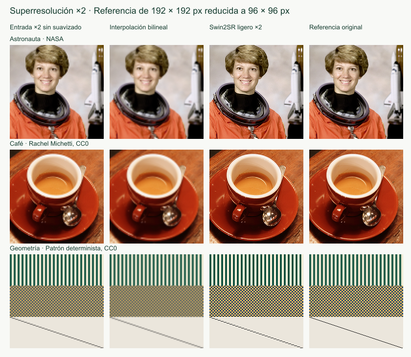

# Superresolución ×2 con Swin2SR

Solución de [victor-acevedo](https://github.com/victor-acevedo) para [la issue #11](https://github.com/nahuelcostac/redes-generativas-26/issues/11).

## Ejecutar la interfaz

Desde la raíz del repositorio, con Node.js 22.12 o posterior y npm.

```sh
npm ci
npm run dev
```

Abre `/redes-generativas-26/solutions/11/victor-acevedo/web/index.html` en la dirección que indique Vite. Para comprobar la versión publicada localmente, ejecuta `npm run build` y `npm run preview`.

1. Selecciona una imagen o uno de los tres ejemplos.
2. Pulsa **Ampliar ×2**. La primera ejecución descarga e inicializa el modelo. La barra muestra el progreso del archivo y, después, el avance por bloques.
3. Compara la entrada, la interpolación bilineal o la referencia con el modelo. Mueve el separador con el ratón o las flechas del teclado.
4. Descarga el PNG. **Guardar registro JSON** descarga los parámetros, el navegador, los tiempos y las imágenes exactas del experimento. El registro se guarda en tu equipo.

Puedes cancelar la carga o el procesamiento. Se termina el worker y se conserva la entrada para volver a intentarlo. Los errores permiten seleccionar otra imagen o repetir la operación.

## Modelo y límites

| Parámetro       | Valor                                                                |
| --------------- | -------------------------------------------------------------------- |
| Modelo          | `Xenova/swin2SR-lightweight-x2-64`                                   |
| Revisión fijada | `92a21aca5713f20faf9a87590cdfbdce2e34112c`                           |
| Modelo base     | `caidas/swin2SR-lightweight-x2-64`                                   |
| Biblioteca      | `@huggingface/transformers` 4.3.1, ya fijada en el repositorio       |
| Ejecución       | Pipeline `image-to-image`, `fp32`, CPU mediante WebAssembly, un hilo |
| Ampliación      | ×2 por lado, cuatro veces el número de píxeles                       |
| Entrada         | PNG, JPEG o WebP, de 1 byte a 5 MiB                                  |
| Dimensiones     | Entre 8 y 256 píxeles por lado, sin reducción automática             |
| Salida          | PNG RGB opaca, hasta 512 × 512 píxeles                               |
| Bloques         | Núcleo de 64 × 64, contexto de 8 píxeles por lado                    |

El procesador del modelo rellena los bloques hasta un múltiplo de 8. El worker recorta ese relleno y el margen antes de copiar cada núcleo en la salida. Esto conserva las dimensiones exactas, también con lados impares. El contexto reduce las uniones, pero no garantiza eliminarlas. La inferencia usa un worker para mantener la interfaz disponible.

Se usa el primer fotograma de los formatos animados admitidos por el decodificador del navegador. La transparencia se compone sobre blanco antes de la inferencia. No se conserva EXIF ni otros metadatos. No se envían los píxeles a un servidor. La primera carga sí conecta con Hugging Face para descargar la configuración y los pesos. La caché pertenece al navegador y queda fuera del repositorio.

Se necesita un navegador moderno con módulos, workers, Canvas 2D, `createImageBitmap` y WebAssembly. El navegador debe poder acceder a Hugging Face y disponer de memoria para ONNX Runtime. No hace falta WebGPU. El límite de 256 píxeles se eligió para acotar memoria y tiempo. No equivale a una garantía para cualquier equipo.

Fuentes técnicas de la implementación

- [Ficha del modelo y ejemplo oficial de Transformers.js](https://huggingface.co/Xenova/swin2SR-lightweight-x2-64).
- [Configuración fijada del modelo](https://huggingface.co/Xenova/swin2SR-lightweight-x2-64/blob/92a21aca5713f20faf9a87590cdfbdce2e34112c/config.json).
- [Documentación de pipelines](https://huggingface.co/docs/transformers.js/api/pipelines).

## Ejemplos y procedencia

Las referencias de `results/` miden 192 × 192 píxeles. La interfaz las reduce a 96 × 96 con Canvas 2D e `imageSmoothingQuality = 'low'`. Después ejecuta el modelo ×2. La ampliación de control usa interpolación bilineal del mismo navegador. La comparación de PSNR calcula el error RGB sobre toda la imagen, sin recortar bordes ni usar el canal alfa. No es una evaluación de referencia con el protocolo oficial de Swin2SR.

| Ejemplo    | Procedencia y permiso                                                                       | Preparación                                                                         |
| ---------- | ------------------------------------------------------------------------------------------- | ----------------------------------------------------------------------------------- |
| Astronauta | NASA, retrato de Eileen Collins. Dominio público. Distribuido en `scikit-image` 0.19.3      | Recorte `(100, 20, 320, 320)` de `astronaut.png`, reducido a 192 × 192 con Lanczos3 |
| Café       | Rachel Michetti, cortesía de Pikolo Espresso Bar. CC0. Distribuido en `scikit-image` 0.19.3 | Recorte `(100, 0, 400, 400)` de `coffee.png`, reducido a 192 × 192 con Lanczos3     |
| Geometría  | Patrón determinista creado mediante código para esta solución. CC0                          | Franjas, damero de 3 píxeles y una diagonal sobre fondo plano                       |

Las atribuciones se pueden verificar en [el código de datos de scikit-image 0.19.3](https://github.com/scikit-image/scikit-image/blob/v0.19.3/skimage/data/_fetchers.py). `results/examples.json` registra las URL originales, los recortes y los SHA-256 de las fotografías descargadas.

Para regenerar las referencias desde la raíz del repositorio

```sh
node solutions/11/victor-acevedo/code/prepare-examples.mjs
```

Este script usa `sharp` 0.35.5, dependencia transitiva ya fijada en `package-lock.json`. Descarga los originales en la carpeta temporal del sistema, verifica sus hashes y guarda solo las referencias pequeñas en `results/`. No instala dependencias nuevas.

Para conservar una ejecución del navegador, descarga su registro y extrae sus imágenes en un directorio nuevo.

```sh
node solutions/11/victor-acevedo/code/extract-run.mjs registro-superresolucion.json solutions/11/victor-acevedo/results/mi-ejecucion
```

`run.json` conserva los metadatos y los hashes. `input.png`, `output.png`, `interpolation.png` y, cuando exista, `reference.png` contienen las imágenes exactas exportadas por el navegador. La web sigue ejecutando el modelo. Los archivos de comprobación no sustituyen la inferencia.

## Comprobaciones

Equipo observado en esta sesión, Intel Core i7-1185G7, 8 procesadores lógicos, 15,83 GiB de RAM y Windows con versión de núcleo 10.0.26300. Se usó el navegador integrado de Codex, con agente de usuario Chrome 156.0.0.0. Los registros de ejecución conservan la identificación completa. Los tiempos varían con el equipo, la caché, la red y la carga del sistema. Carga incluye descarga, compilación de WASM e inicialización. Procesamiento incluye preparación, inferencia y unión de bloques, pero no la codificación PNG en el hilo principal.

Primera pasada observada el 30 de octubre de 2026

| Ejemplo    | Entrada → salida    | Carga              | Procesamiento | PSNR modelo | PSNR interpolación |
| ---------- | ------------------- | ------------------ | ------------- | ----------- | ------------------ |
| Astronauta | 96 × 96 → 192 × 192 | 30,95 s            | 2,69 s        | 28,87 dB    | 27,25 dB           |
| Café       | 96 × 96 → 192 × 192 | Modelo reutilizado | 2,68 s        | 29,57 dB    | 27,37 dB           |
| Geometría  | 96 × 96 → 192 × 192 | Modelo reutilizado | 2,44 s        | 21,75 dB    | 17,14 dB           |

Se comprobó la descarga PNG y el rechazo de un archivo de texto y de un PNG dañado. Las pruebas de código comprueban formatos, límite de archivo, dimensiones, cobertura de bloques sin duplicados y cálculo PSNR. Las comprobaciones finales y los registros de la segunda pasada se detallan en `results/verification.json`.

La segunda pasada conserva cinco registros completos en `results/runs/`. Astronauta tardó 3,06 s de procesamiento y 10,49 s de inicialización con caché. Café tardó 2,53 s y Geometría 2,83 s con el modelo reutilizado. Las métricas de calidad coincidieron con la primera pasada. También se comprobó una entrada WebP transparente de 91 × 137, con salida exacta de 182 × 274 y 4,12 s de procesamiento. La entrada JPEG máxima de 256 × 256 produjo 512 × 512 en 18,36 s. Una entrada de 257 × 32 se rechazó. La cancelación permitió repetir la inferencia correctamente.

Los registros guardan las imágenes después de la decodificación y la composición sobre blanco. La entrada WebP de prueba era un color semitransparente creado con código. El JPEG máximo se preparó al ampliar la referencia Café a 256 × 256 con sharp. Estas dos pruebas comprueban el flujo y las dimensiones, no la recuperación de detalle ni la PSNR.

Para verificar los archivos y recrear la figura de comparación desde la raíz

```sh
node solutions/11/victor-acevedo/code/verify-runs.mjs
node solutions/11/victor-acevedo/code/make-comparison.mjs
```

El primer script comprueba hashes, dimensiones y PSNR directamente contra los PNG exportados. El segundo solo organiza las imágenes existentes en una figura. No ejecuta el modelo ni altera sus salidas.



Observaciones visuales de esta ejecución

- Astronauta recupera bordes del casco y mechones de pelo respecto a la interpolación. La piel y los ojos pierden parte de la textura fina de la referencia.
- Café muestra el borde de la taza más definido. Las pequeñas marcas de la madera y los reflejos no se recuperan de forma exacta.
- Geometría revela aliasing. El modelo crea un damero con frecuencia distinta de la referencia y deja escalones en la diagonal. La mejora de PSNR no elimina estos errores.

## Límites de calidad

Una PSNR mayor indica menor error de píxel frente a la referencia, no que el detalle sea verdadero. Las imágenes reducidas artificialmente son un caso más sencillo que una fotografía pequeña, comprimida o desenfocada. Los resultados no demuestran una mejora general sobre cualquier entrada. Tampoco evalúan otros navegadores ni dispositivos móviles.

## Trabajo del agente para revisar

El agente creó esta contribución con el generador del repositorio, implementó el worker y la interfaz, preparó ejemplos con procedencia y realizó las comprobaciones. La decisión principal fue usar Swin2SR ligero en `fp32` con bloques pequeños para ejecutar el mismo flujo en CPU sin exigir WebGPU. El alumno debe revisar el recorte de los márgenes, el límite de entrada y la comparación de calidad. Las pruebas y los archivos exportados permiten comprobar esas decisiones. Se conservan las contribuciones de otros alumnos y los archivos compartidos. La issue permanece abierta.

Para una futura pull request, incluye `Related to #11`.
